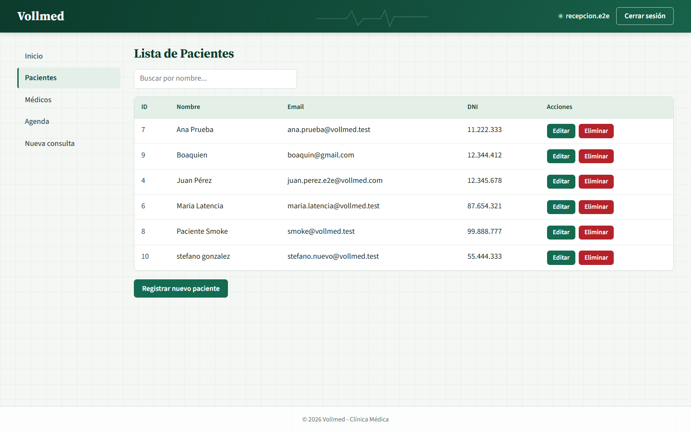

# Clínica Médica Vollmed

Aplicación web para la gestión de una clínica médica. Combina una **API REST en Java 17 con Spring Boot 4** y una **SPA en React 19**, e incluye autenticación JWT, administración de pacientes y médicos, agenda en tiempo real y reserva de consultas con las reglas de negocio de la clínica.



## Contenido

- [Tecnologías](#tecnologías)
- [Funcionalidades](#funcionalidades)
- [Estructura del repositorio](#estructura-del-repositorio)
- [Requisitos](#requisitos)
- [Configuración](#configuración)
- [Ejecución](#ejecución)
- [Pruebas](#pruebas)
- [Documentación](#documentación)
- [Datos de ejemplo](#datos-de-ejemplo)
- [Reglas de negocio](#reglas-de-negocio)
- [Licencia](#licencia)

## Tecnologías

### Backend

- **Java 17** y **Spring Boot 4.1.1**
- **Spring Web MVC**, **Spring Data JPA** e **Hibernate 7**
- **Spring Security 7** con autenticación **JWT** (`java-jwt 4.6.1`)
- **MySQL 8** y **Flyway** para migraciones
- **Springdoc OpenAPI 3.1.1** para la documentación interactiva
- **WebSocket** para avisar de cambios en la agenda
- **Lombok**, **Maven** y pruebas con **JUnit 5** y **Spring Security Test**

### Frontend

- **React 19** y **React Router 7**
- **Vite 8** como servidor de desarrollo y empaquetador
- **CSS propio** con diseño responsive e identidad visual de la clínica
- Pruebas de componentes y utilidades con **node:test**, **Testing Library** y **jsdom**

## Funcionalidades

### API REST

- CRUD de médicos y pacientes con borrado lógico y paginación.
- Registro, listado, detalle y cancelación de consultas.
- Validaciones de negocio: horarios, anticipación, disponibilidad e inactividad.
- Asignación automática de un médico disponible cuando no se indica uno.
- Manejo estructurado de errores y respuestas de validación.
- Autenticación y autorización mediante JWT.
- Documentación de la API con Swagger UI.

### Interfaz web

- Inicio de sesión y rutas protegidas; cierre automático de sesión por inactividad.
- **Pacientes**: búsqueda, alta, edición y eliminación lógica.
- **Médicos**: búsqueda por nombre, filtro por especialidad, alta y edición.
- **Agenda**: filtro por médico y fecha, actualización en tiempo real por WebSocket.
- **Nueva consulta**: selección de paciente, médico y horario según disponibilidad.
- Mensajes de error accesibles, foco visible y navegación adaptada a móvil.

## Estructura del repositorio

```text
Clinica-Medica/
├── api/                     # Proyecto Spring Boot
│   ├── src/main/java/       # Código de la API por dominio
│   ├── src/main/resources/  # Configuración y migraciones Flyway
│   ├── src/test/java/       # Pruebas del backend
│   ├── frontend/            # Aplicación React + Vite
│   ├── test/                # Pruebas de servicios, hooks y utilidades
│   ├── docs/                # Guía de usuario y capturas
│   └── specs/               # Especificación y plan de la interfaz
├── LICENSE
└── README.md
```

## Requisitos

- **Java 17** o superior.
- **MySQL 8** en ejecución.
- **Node.js 20** o superior y **npm** (para el frontend).
- Maven no es necesario: el proyecto incluye el wrapper `mvnw`.

## Configuración

El backend toma la conexión de base de datos y el secreto JWT de variables de entorno. Los valores por defecto permiten trabajar en local, salvo la contraseña de MySQL, que es obligatoria.

| Variable | Descripción | Valor por defecto |
| --- | --- | --- |
| `VOLLMED_DB_URL` | URL JDBC de la base principal | `jdbc:mysql://localhost:3306/vollmed_api` |
| `VOLLMED_DB_USERNAME` | Usuario de MySQL | `root` |
| `VOLLMED_DB_PASSWORD` | Contraseña de MySQL | **sin valor: hay que definirla** |
| `VOLLMED_JWT_SECRET` | Secreto para firmar los JWT | Secreto solo para desarrollo |

Bases de datos necesarias:

- `vollmed_api` para la aplicación.
- `vollmed_api_test` para las pruebas del backend.

Flyway crea y actualiza el esquema automáticamente al arrancar.

En producción existe el perfil `production`, que utiliza `DATASOURCE_URL`, `DATASOURCE_USERNAME` y `DATASOURCE_PASSWORD`.

## Ejecución

### 1. Backend

```bash
cd api
./mvnw spring-boot:run
```

En Windows:

```powershell
cd api
.\mvnw.cmd spring-boot:run
```

La API queda disponible en `http://localhost:8080`.

### 2. Frontend

En otra terminal:

```bash
cd api/frontend
npm install
npm run dev
```

La aplicación se abre en `http://localhost:5173`. Vite redirige `/api` al backend y `/ws` al WebSocket.

Para generar la versión de producción:

```bash
npm run build
```

## Pruebas

### Backend

Requiere MySQL en ejecución y las bases `vollmed_api` y `vollmed_api_test`:

```bash
cd api
./mvnw test
```

En Windows: `.\mvnw.cmd test`.

### Frontend

Desde `api/`, con las dependencias instaladas:

```bash
node --test "test/*.test.mjs" "frontend/test/componentes/*.test.mjs"
```

La suite cubre servicios, hooks, utilidades, componentes y maquetación (140 pruebas).

## Documentación

- **Swagger UI**: `http://localhost:8080/swagger-ui.html`
- **Guía de usuario**: [`api/docs/guia-usuario.md`](api/docs/guia-usuario.md)
- **Especificación de la interfaz**: [`api/specs/001-front-end/spec.md`](api/specs/001-front-end/spec.md)
- **Plan de implementación**: [`api/specs/001-front-end/plan.md`](api/specs/001-front-end/plan.md)

## Datos de ejemplo

Para probar la interfaz en un entorno local se incluye el usuario de demostración:

- **Usuario**: `recepcion.e2e`
- **Contraseña**: `Vollmed2026!`

Son credenciales de ejemplo para desarrollo; no deben utilizarse en producción.

## Reglas de negocio

- Atención de lunes a sábado, de 07:00 a 19:00.
- Consultas de una hora de duración.
- Reserva con al menos 30 minutos de anticipación.
- No se puede reservar con médicos o pacientes inactivos.
- Un paciente no puede tener más de una consulta el mismo día.
- El médico no puede tener dos consultas en el mismo horario.
- Si no se indica médico, se asigna uno disponible automáticamente.

## Licencia

Este proyecto se distribuye bajo la licencia **Apache 2.0**. Consulta el archivo [LICENSE](LICENSE) para más detalles.
